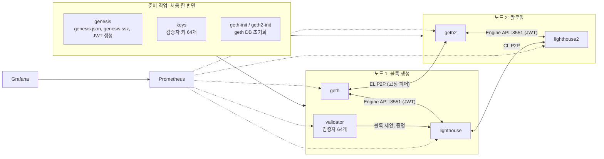
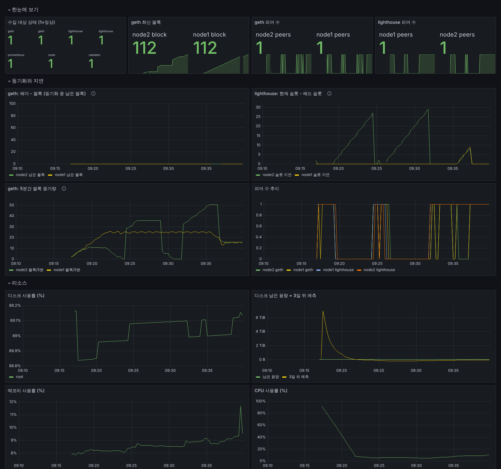

# 로컬 개발 네트워크(devnet)로 노드 운영 연습하기

디스크가 부족해서 Sepolia 풀 노드(1TB급 SSD 필요)를 못 띄울 때 쓰는 대안입니다. Geth와 Lighthouse로 **내 PC 안에만 있는 사설 이더리움 PoS 네트워크**를 만들고, Sepolia 가이드와 같은 모니터링(Prometheus, Grafana, 알림)과 장애 연습을 그대로 합니다.

| | Sepolia 풀 노드 (`../sepolia-node`) | 이 devnet |
|---|---|---|
| 디스크 | 1TB급 SSD | 시작 시 약 0.7GB (아래 실측값 참고) |
| 메모리 | 16GB 권장 | 컨테이너 합계 약 0.7GB (실측) |
| 첫 블록까지 | 동기화에 하루 안팎 | 약 1분 |
| 실행 + 합의 클라이언트 JWT 연결 | O | O |
| 블록 생성 (검증자) | X | O (검증자 64개를 직접 돌림) |
| 피어와 동기화 | 공용 네트워크의 수십 개 피어 | 내 PC 안의 노드 2개끼리 |
| 모니터링, 알림, 장애 연습 | O | O (같은 설정 파일을 씀) |

**면접에서 말할 때**: "디스크 제약으로 공용 테스트넷 풀 노드 대신, Geth와 Lighthouse로 사설 PoS 개발 네트워크를 직접 구성해 2개 노드를 돌리고, 모니터링과 장애 연습을 했다"고 사실대로 말하세요. 공용 네트워크 동기화는 해 보지 않았다는 점도 함께 말하는 편이 신뢰를 줍니다.

> **검증 상태**: 이 구성은 2026-10-12에 리눅스 + Docker Engine 29에서 실제로 띄워 블록 생성, 2노드 피어링, Prometheus 수집, 알림 발생, 장애 연습 1·2와 디스크 측정을 확인했습니다. 아래 숫자는 그때의 실측값입니다. 도연 님 PC에서는 다를 수 있으니 직접 잰 값으로 기록하세요.

---

## 1. 구성



- **genesis**: [ethpandaops/ethereum-genesis-generator](https://github.com/ethpandaops/ethereum-genesis-generator)가 실행 클라이언트용 `genesis.json`, 합의 클라이언트용 `genesis.ssz`와 `config.yaml`, 두 클라이언트가 함께 쓸 JWT 비밀키를 한 번에 만듭니다. 설정은 `values.env`입니다.
- **keys**: `eth2-val-tools`가 공개 개발용 니모닉에서 검증자 키 64개를 만듭니다. **이 니모닉은 공개된 값이라 실제 자산에 절대 쓰면 안 됩니다.**
- **노드 1**은 검증자를 붙여 12초마다 블록을 만들고, **노드 2**는 검증자 없이 노드 1을 따라가기만 합니다. 노드 2가 있어야 "피어가 끊겼다가 다시 붙어 따라잡는" 연습을 할 수 있습니다.
- 모니터링 설정(Grafana 대시보드)은 `../sepolia-node`의 파일을 그대로 씁니다. 알림 규칙만 devnet용(`alerts.yml`, 피어 기준을 1로 낮춤)을 씁니다.

### 포트 (모두 127.0.0.1에만 열림)

| 포트 | 서비스 |
|---|---|
| 8545 / 8546 | geth / geth2 JSON-RPC |
| 5052 / 5053 | lighthouse / lighthouse2 Beacon API |
| 9090 | Prometheus |
| 3000 | Grafana (admin / `change-me`, `.env`의 `GRAFANA_ADMIN_PASSWORD`로 변경) |

외부에 여는 포트가 없어서 공유기 설정이나 방화벽 작업이 필요 없습니다.

---

## 2. 실행

필요한 것: Docker Engine과 Compose v2(`docker compose version`), `curl`, `python3`. Docker Desktop이면 [아래 메모](#docker-desktop-메모)도 보세요.

```bash
cd devnet
docker compose up -d          # 처음엔 이미지 내려받기 때문에 몇 분 걸림
docker compose ps -a          # genesis, keys, *-init, enr-fetch 는 Exited (0), 나머지는 Up 이면 정상
```

1분쯤 지나면 블록이 올라가기 시작합니다.

```bash
../sepolia-node/scripts/check.sh                                              # 노드 1
RPC=http://127.0.0.1:8546 BEACON=http://127.0.0.1:5053 ../sepolia-node/scripts/check.sh   # 노드 2
```

처음 실행 때 실제로 본 로그 (형식 참고용):

```
validator  | INFO  Successfully published block   block_type: Full, ... slot: 14
lighthouse | INFO  Valid block from HTTP API     block_delay: 13.89ms, ... slot: 14
geth       | INFO  Chain head was updated        number=3 hash=6e4e8a..e53d5b
```

노드 1 Lighthouse에 `Could not publish message error: NoPeersSubscribedToTopic` 경고가 보이면, 노드 2가 아직 안 붙었거나 끊긴 것입니다. 노드 2가 붙으면 사라집니다.

### 멈추기, 다시 켜기, 처음부터 다시

```bash
docker compose stop           # 잠시 멈춤 (데이터 유지)
docker compose start
./scripts/reset.sh            # 컨테이너와 체인 데이터를 모두 지우고 초기화
docker compose up -d          # 새 genesis(현재 시각 기준)로 새 체인 시작
```

PC를 며칠 꺼 두었다가 켜면, 그동안 지나간 빈 슬롯을 처리하느라 따라잡는 데 시간이 걸립니다. 연습 목적이면 `reset.sh` 후 새로 시작하는 편이 빠릅니다.

---

## 3. 상태 확인과 모니터링

JSON-RPC, Beacon API 호출, Grafana, Prometheus 사용법은 [Sepolia 가이드 4~5절](../sepolia-node/README.md#4-동기화와-상태-확인)과 같습니다. 포트만 위 표대로 바꾸면 됩니다. 체인 ID는 `0x3018a4`(3151908)입니다.

- Grafana: http://localhost:3000 → Dashboards → Sepolia → **Sepolia Node** (같은 대시보드. 범례에 `node1`, `node2`가 붙어서 나옴)
- Prometheus 수집 대상: http://localhost:9090/targets (geth 2개, lighthouse 2개, validator, node, prometheus 모두 UP)
- 알림: http://localhost:9090/alerts

장애 연습 1·2를 한 뒤의 실제 대시보드 (슬롯 지연 패널의 두 봉우리가 연습 2의 단절 구간):



devnet에서만 볼 만한 지표:

| 지표 | 의미 |
|---|---|
| `vc_validators_total_count` | 검증자 클라이언트가 불러온 검증자 수 (64) |
| `beacon_finalized_epoch` | 확정(finalized)된 에포크. 검증자가 정상이면 몇 에포크마다 올라감 |

---

## 4. 장애 연습 (devnet 버전)

[장애 연습 문서](../sepolia-node/docs/incident-drills.md)의 네 칸(증상, 원인, 조치, 재발 방지)을 그대로 쓰되, 명령은 아래 devnet 버전을 쓰세요.

### 연습 1. 클라이언트 재시작

```bash
date '+%T'; docker compose restart geth           # 노드 1 실행 클라이언트 재시작
docker compose logs -f --since 2m lighthouse      # 실행 엔진 연결 끊김/복구 로그 확인
```

```bash
date '+%T'; docker kill geth                      # 비정상 종료
docker compose ps geth                            # 자동으로 다시 안 뜨는 것 확인 (docker kill 은 "사용자가 멈춘 것")
docker compose start geth
```

노드 1의 geth가 멈추면 **블록 생성 자체가 멈춥니다**(검증자가 블록을 만들 실행 클라이언트가 없음). 노드 2도 새 블록을 못 받습니다. "한 컴포넌트 장애가 어디까지 번지나"를 관찰하기 좋은 연습입니다.

2026-10-12 실측 결과:

| 연습 | 관찰 |
|---|---|
| 1-A `restart` | 1초 만에 재시작. 다음 슬롯(9초 뒤)에 블록이 정상 생성되어 **놓친 블록 없음**. Lighthouse와 검증자 로그에 경고 없음 |
| 1-B `kill` 직후 | Lighthouse `ERROR Error during execution engine upcheck ... http://geth:8551/ ... client error (Connect)`, Beacon API `el_offline: true`. 블록 번호가 100에서 멈춤. 75초 뒤 `TargetDown`(node1) Pending. `docker inspect`로 보면 `exited` 상태로 자동 재시작 안 됨 |
| 1-B `start` 후 | geth 로그 `Loaded most recent local block number=97`. **죽기 직전 블록 100이 아니라 97로 돌아감**(디스크에 아직 안 쓴 최근 블록 3개를 잃음). 이어서 `Fetching the unknown forkchoice head from network`, `Could not retrieve unknown head from peers` 경고 후 피어(geth2)에게서 받아 복구 |
| 복구 중 | Lighthouse `ERROR Exec engine unable to produce payload msg: "No payload ID, the engine is likely syncing..."`, 검증자 블록 제안 실패. kill부터 첫 새 블록까지 약 2분, 그 사이 슬롯 약 20개가 블록 없이 지나감 |

배운 점으로 적을 만한 것: 정상 종료(`restart`, `stop`)는 데이터를 디스크에 정리하고 끝나서 손실이 없지만, 비정상 종료(`kill`, 전원 차단)는 최근 데이터를 잃고 복구에 시간이 걸립니다. compose의 `stop_grace_period`(종료 시 기다려 주는 시간)를 두는 이유이고, 피어가 있어야 잃은 블록을 다시 받을 수 있다는 것도 확인할 수 있습니다.

### 연습 2. 피어 수 급감 → 따라잡기

노드 2를 공용 네트워크에서만 떼어 냅니다. 노드 2의 geth2와 lighthouse2는 전용 네트워크(`node2-internal`)로 계속 연결돼 있고, Prometheus도 그 네트워크로 계속 수집하므로 "피어만 끊긴" 상황이 됩니다.

```bash
date '+%T'
docker network disconnect devnet_default geth2
docker network disconnect devnet_default lighthouse2
# 6분 이상 기다리며 Grafana 피어 수 / 슬롯 지연 패널과 http://localhost:9090/alerts 관찰
docker compose logs --since 3m lighthouse2 | grep -i peer
docker compose logs --since 3m geth2 | grep -i static
# 복구
date '+%T'
docker network connect devnet_default geth2
docker network connect devnet_default lighthouse2
```

2026-10-12 실측 결과 (5분 단절):

| 시점 | 관찰 |
|---|---|
| 단절 직후 | lighthouse2 로그 `WARN Low peer count peer_count: "0"`이 12초마다 반복. geth2 로그 `DNS lookup of static node failed ... name=geth` (고정 피어에 다시 붙으려고 계속 시도) |
| +2분 | `BeaconSlotLag`(node2) Pending. 노드 2 헤드가 슬롯 30에 멈추고 `sync_distance`가 계속 커짐 |
| +5분 | 노드 1 블록 43, 노드 2 블록 18 (25블록 뒤처짐). `GethLowPeers`(node1, node2), `GethHeadStalled`(node2) Pending |
| 재연결 | **3초 안에** 노드 2가 25블록을 받아 따라잡음 (geth2 로그 `Imported new potential chain segment ... age=5m14s`부터 차례로) |

**연습 중 실제로 찾은 문제 2가지** (기록에 그대로 쓸 만한 사례):
1. Lighthouse v8.2.3의 `libp2p_peers` 지표는 피어가 붙어 있어도 0으로 나왔습니다. API(`/eth/v1/node/peer_count`)와 비교해서 찾았고, `sync_peers_per_status`의 합으로 바꿨습니다.
2. 그런데 바꾼 지표는 피어가 0이 되면 **값이 0이 아니라 아예 사라져서**, 피어 부족 알림이 영영 울리지 않았습니다. 연습 중에 알림이 안 울리는 것을 보고 찾았고, `or (up{job="lighthouse"} * 0)`으로 0을 채워 고쳤습니다.

> 이렇게 "알림이 장애 때 실제로 울리는지"를 연습으로 확인하고 고친 경험이, 공고의 "모니터링으로 잡고 원인을 찾아 재발을 막는" 업무와 가장 직접 연결됩니다.

### 연습 3. 디스크 사용량 증가

devnet은 디스크를 거의 안 쓰므로, "증가 속도를 재고 예측하는" 쪽에 집중합니다.

```bash
date '+%F %T' >> disk-log.txt; du -s --block-size=1M data/* >> disk-log.txt
```

몇 시간 간격으로 두 번 이상 재서 시간당 증가량을 구하고, Grafana의 "디스크 남은 용량 + 3일 뒤 예측" 패널과 비교하세요. 알림이 실제로 울리는지는 [Sepolia 가이드 연습 3-B 방법 1](../sepolia-node/docs/incident-drills.md#3-b-알림이-실제로-울리는지-확인)처럼 기준값을 잠시 낮춰서 확인합니다. devnet은 `alerts.yml`을 쓰므로 그 파일을 고치세요.

```bash
sed -i 's/) \* 100 > 80/) * 100 > 10/' alerts.yml && docker compose restart prometheus
# 5분 뒤 DiskUsageHigh Firing 확인, 스크린샷
git checkout alerts.yml && docker compose restart prometheus
```

2026-10-12 실측값 (`du -s --block-size=1M`):

| 시점 | geth | geth2 | lighthouse | lighthouse2 | prometheus |
|---|---|---|---|---|---|
| 블록 약 10개 (09:16) | 283MB | 283MB | 34MB | 24MB | 3MB |
| 블록 약 100개 (09:37) | **1MB** | 283MB | 78MB | 61MB | 8MB |

geth가 283MB에서 1MB로 **줄어든** 것은 이상해 보이지만 원인이 있습니다. 283MB는 체인 데이터가 아니라 DB가 미리 잡아 둔 쓰기 로그 파일(`chaindata/*.log`)이었고, geth를 재시작하면서 정리됐습니다(geth2는 재시작하지 않아 그대로). `du -sh data/geth/geth/*`로 하위 폴더별로 보면 확인할 수 있습니다. 디스크 사용량은 이렇게 계단식으로 움직이기도 하니, 한 번 잰 값보다 여러 번 잰 추세를 보세요.

---

## Docker Desktop 메모

- 이 devnet은 데이터가 작아서 `./data` 폴더에 그대로 둬도 됩니다. 다만 Windows는 WSL(Ubuntu) 안에 저장소를 clone 하고 그 터미널에서 실행하세요. 스크립트에 bash가 필요합니다.
- Settings → Resources에서 메모리 4GB 이상이면 충분합니다.
- node-exporter가 보는 CPU, 메모리, 디스크는 PC가 아니라 Docker Desktop VM 기준입니다.

## 파일

```
devnet/
├── docker-compose.yml   # 준비 작업 5개 + 노드 2쌍 + 검증자 + 모니터링
├── values.env           # genesis 설정 (체인 ID, 검증자 수, 슬롯 시간)
├── geth2.toml           # geth2 의 고정 피어(노드 1) 설정
├── prometheus.yml       # 수집 대상 (node1/node2 라벨)
├── alerts.yml           # devnet 용 알림 규칙 (피어 기준 1)
└── scripts/reset.sh     # 처음 상태로 초기화
```

이미지는 실제로 검증한 버전으로 고정했습니다: `ethereum/client-go:v1.17.8`, `sigp/lighthouse:v8.2.3`, `ethpandaops/ethereum-genesis-generator:6.2.4`. 검증자 키 생성 도구 `protolambda/eth2-val-tools`는 버전 태그가 없어 `latest`를 씁니다. 올리고 싶으면 `.env`에 `GETH_IMAGE=`, `LIGHTHOUSE_IMAGE=`를 넣고, 올린 뒤 위 연습을 한 번 다시 해 보세요. 그것도 좋은 기록거리입니다.
