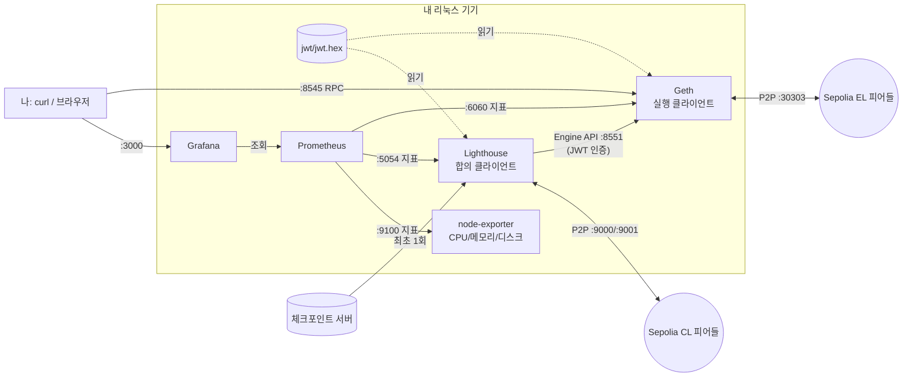

# Sepolia 노드 직접 띄우기: 실행부터 모니터링, 장애 연습까지

이더리움 테스트넷 Sepolia의 풀 노드를 Docker Compose로 띄웁니다. 실행 클라이언트는 Geth, 합의 클라이언트는 Lighthouse입니다. Prometheus와 Grafana로 상태를 보고, 장애 연습 세 가지를 직접 해 본 뒤 기록으로 남기는 것까지가 목표입니다.

| 문서 | 내용 |
|---|---|
| 이 README | 구성 이해, 준비물, 실행, 동기화 확인, 모니터링 |
| [docs/incident-drills.md](docs/incident-drills.md) | 장애 연습 3가지 (증상, 원인, 조치, 재발 방지) |
| [docs/log-template.md](docs/log-template.md) | 작업 기록 템플릿 (README나 블로그 글로 그대로 옮겨 쓸 수 있음) |

> **확인 기준**: 아래 플래그와 기본 포트는 2026-10-12에 Geth 문서([command-line options](https://geth.ethereum.org/docs/fundamentals/command-line-options), [hardware](https://geth.ethereum.org/docs/getting-started/hardware-requirements)), Lighthouse 문서([run a node](https://lighthouse-book.sigmaprime.io/run_a_node.html), [bn help](https://lighthouse-book.sigmaprime.io/help_bn.html)), [체크포인트 동기화 주소 목록](https://eth-clients.github.io/checkpoint-sync-endpoints/)을 보고 맞췄습니다. 클라이언트 버전이 바뀌면 달라질 수 있으니, 실행 전에 `docker run --rm <이미지> --help`로 한 번 더 확인하세요.

---

## 1. 구성 이해

머지(The Merge) 이후 이더리움 노드는 프로그램 두 개가 한 쌍으로 돌아갑니다.

| 역할 | 이 가이드 | 하는 일 |
|---|---|---|
| 실행 클라이언트 (EL) | Geth | 트랜잭션 실행, 상태(잔액, 컨트랙트) 저장, 사용자용 JSON-RPC 제공 |
| 합의 클라이언트 (CL) | Lighthouse | 비콘 체인을 따라가며 "어느 블록이 정답인지" 결정하고 EL에 알려 줌 |

둘은 **Engine API**(포트 8551)로 대화합니다. 아무나 이 API로 Geth에 명령하면 안 되므로, 두 클라이언트는 같은 **JWT 비밀키 파일**(`jwt/jwt.hex`)을 읽고 요청마다 그 키로 서명한 토큰을 주고받습니다. 키가 다르면 Lighthouse 로그에 인증 실패가 찍히고 동기화가 멈춥니다.



### 포트 정리

| 포트 | 서비스 | 공개 범위 | 용도 |
|---|---|---|---|
| 30303 tcp/udp | geth | 외부 | EL P2P (피어와 블록·트랜잭션 교환) |
| 9000 tcp/udp, 9001 udp | lighthouse | 외부 | CL P2P (9001은 QUIC) |
| 8545 | geth | 127.0.0.1 | JSON-RPC (`eth_blockNumber` 등) |
| 8551 | geth | 컨테이너 내부 | Engine API (Lighthouse 전용, JWT) |
| 5052 | lighthouse | 127.0.0.1 | Beacon REST API |
| 6060 / 5054 / 9100 | geth / lighthouse / node-exporter | 컨테이너 내부 | Prometheus 지표 |
| 9090 | prometheus | 127.0.0.1 | 지표 조회, 알림 상태 |
| 3000 | grafana | 127.0.0.1 | 대시보드 |

RPC와 대시보드는 같은 기기에서만 열리게 묶었습니다. 다른 PC에서 보고 싶으면 포트를 여는 대신 `ssh -L 3000:localhost:3000 user@서버`로 터널을 쓰세요.

### 디렉터리 구조

```
sepolia-node/
├── docker-compose.yml        # 5개 서비스 정의
├── .env.example              # 이미지 태그, 데이터 경로, 연습용 값
├── prometheus/
│   ├── prometheus.yml        # 수집 대상
│   └── alerts.yml            # 알림 규칙 (피어 부족, 블록 정지, 디스크 등)
├── grafana/                  # 데이터소스와 대시보드 자동 등록
├── scripts/
│   ├── gen-jwt.sh            # JWT 비밀키 생성
│   └── check.sh              # 동기화/블록/피어/디스크 한 번에 확인
└── docs/                     # 장애 연습, 기록 템플릿
```

---

## 2. 준비물

### 하드웨어

| 항목 | 권장 | 근거 |
|---|---|---|
| 디스크 | **SSD 1TB 이상** (HDD는 동기화가 끝나지 않을 수 있음) | Geth 문서는 메인넷 snap 풀 노드에 650GB 이상, EL+CL 합쳐 2TB SSD를 권장합니다. Sepolia는 메인넷보다 작지만 공식 수치가 없고, 한 커뮤니티 가이드는 Sepolia Geth+Lighthouse에 850GB 여유 공간을 적었습니다(작성일 미상). 처음 이틀간 `du`로 실제 증가량을 재서 기록에 남기세요. |
| 메모리 | 16GB 이상 | Geth 문서 권장값 |
| CPU | 4코어 | Geth 문서 권장값 (2코어+하이퍼스레딩도 가능) |
| 네트워크 | 상시 연결, 데이터 무제한 | 동기화 중 수백 GB를 내려받습니다 |

### 환경별 메모

**공통**: Docker Engine과 Compose v2(`docker compose version`), `openssl`, `curl`, `python3`이 필요합니다.

**WSL2 (Windows PC)**
- 데이터는 반드시 리눅스 쪽 경로(예: `~/sepolia-node/data`)에 두세요. `/mnt/c/...`에 두면 디스크 I/O가 크게 느려집니다.
- WSL2 가상 디스크는 기본적으로 크기가 정해져 있습니다. `df -h ~`로 남은 용량을 먼저 확인하세요.
- `%UserProfile%\.wslconfig`에서 메모리를 넉넉히 주세요. 예: `[wsl2]` 아래 `memory=12GB`.
- Windows 절전 모드가 켜지면 노드가 멈춥니다. 전원 설정에서 "절전 안 함"으로 바꾸세요.
- 외부에서 들어오는 P2P 연결은 기본적으로 막혀 있습니다. 나가는 연결만으로도 동기화는 되지만 피어 수가 적을 수 있습니다. 이것도 기록할 거리입니다.

**집 서버 (우분투 등)**
- 공유기에서 30303(tcp/udp), 9000(tcp/udp), 9001(udp)을 서버로 포트포워딩하면 피어 수가 늘고 안정됩니다.
- `ufw`를 쓴다면 같은 포트를 허용하세요. 8545, 3000 등은 열지 마세요.

**클라우드 VM**
- 디스크 용량과 트래픽 요금이 비용 대부분입니다. 시작 전에 월 예상 비용을 확인하고, 연습이 끝나면 VM과 디스크를 꼭 삭제하세요.
- 보안 그룹에는 P2P 포트만 여세요.

---

## 3. 실행

```bash
git clone <이 저장소> && cd <저장소>/sepolia-node
cp .env.example .env            # 필요하면 DATA_DIR, GRAFANA_ADMIN_PASSWORD 수정
./scripts/gen-jwt.sh            # jwt/jwt.hex 생성
docker compose pull
docker compose up -d
docker compose ps               # 5개 모두 running 인지 확인
```

처음 1분 안에 볼 로그:

```bash
docker compose logs -f lighthouse   # "Starting checkpoint sync" → "Loaded checkpoint block and state"
docker compose logs -f geth         # Lighthouse가 붙은 뒤 "Syncing beacon headers" 등이 보이기 시작
```

> 로그 문구는 버전마다 조금씩 다릅니다. 처음 본 실제 문구를 기록 템플릿에 그대로 붙여 두면, 나중에 장애 때 비교 기준이 됩니다.

종료와 재시작:

```bash
docker compose stop          # geth는 stop_grace_period(3분) 동안 DB를 안전하게 닫음
docker compose start
docker compose down          # 컨테이너 삭제 (data/ 는 남음)
```

---

## 4. 동기화와 상태 확인

### 동기화 순서

1. **Lighthouse 체크포인트 동기화** (보통 수 분): 체크포인트 서버에서 최근 확정 상태를 받아 거기서부터 따라갑니다. 과거 블록은 이후 백그라운드에서 채웁니다(backfill).
2. **Geth snap 동기화** (수 시간~하루 이상): Lighthouse가 알려 준 헤드를 기준으로 헤더, 블록, 상태를 내려받습니다. 가장 오래 걸리는 구간입니다. Lighthouse 문서도 EL 동기화가 "클라이언트와 하드웨어에 따라 몇 시간에서 며칠"이라고 적고 있습니다.
3. **따라잡기 완료**: 12초마다 새 블록이 하나씩 올라갑니다.

Geth 동기화 중에는 Lighthouse 로그에 EL이 동기화 중이라는 경고가 반복될 수 있습니다. 정상입니다.

### 한 번에 확인

```bash
./scripts/check.sh
watch -n 60 ./scripts/check.sh     # 1분마다 갱신
```

### 직접 호출해 보기 (면접에서 설명하기 좋은 부분)

```bash
# 동기화 상태: 진행 중이면 객체(currentBlock, highestBlock 등), 끝나면 false
curl -s -H 'Content-Type: application/json' \
  -d '{"jsonrpc":"2.0","id":1,"method":"eth_syncing","params":[]}' localhost:8545

# 최신 블록 번호 (16진수 → 10진수 변환)
curl -s -H 'Content-Type: application/json' \
  -d '{"jsonrpc":"2.0","id":1,"method":"eth_blockNumber","params":[]}' localhost:8545 \
  | python3 -c 'import sys,json; print(int(json.load(sys.stdin)["result"],16))'

# 피어 수
curl -s -H 'Content-Type: application/json' \
  -d '{"jsonrpc":"2.0","id":1,"method":"net_peerCount","params":[]}' localhost:8545

# 체인 ID: Sepolia면 0xaa36a7 (11155111)
curl -s -H 'Content-Type: application/json' \
  -d '{"jsonrpc":"2.0","id":1,"method":"eth_chainId","params":[]}' localhost:8545

# Lighthouse 쪽
curl -s localhost:5052/eth/v1/node/syncing      # head_slot, sync_distance, is_syncing, el_offline
curl -s localhost:5052/eth/v1/node/peer_count
curl -s localhost:5052/eth/v1/node/health -o /dev/null -w '%{http_code}\n'  # 200 정상, 206 동기화 중
```

동기화가 끝났는지 교차 확인하려면 내 노드의 최신 블록 번호를 공개 Sepolia 블록 탐색기(예: sepolia.etherscan.io)의 최신 블록과 비교하세요. 차이가 1~2블록이면 따라잡은 것입니다.

### 리눅스에서 자원 직접 보기

```bash
docker stats --no-stream            # 컨테이너별 CPU/메모리
du -sh data/*                       # 클라이언트별 디스크 사용량
df -h .                             # 파일시스템 여유
iostat -x 5                         # 디스크 대기(%util, await). sysstat 패키지 필요
free -h
```

---

## 5. 모니터링

`docker compose up -d`만으로 Prometheus와 Grafana가 같이 뜨고, 데이터소스와 대시보드가 자동으로 등록됩니다.

- Grafana: http://localhost:3000 (admin / `.env`의 비밀번호) → Dashboards → Sepolia → **Sepolia Node**
- Prometheus 수집 상태: http://localhost:9090/targets (4개 모두 UP이어야 함)
- 알림 상태: http://localhost:9090/alerts

### 대시보드 패널과 공고 항목 연결

| 패널 | 지표 (PromQL) | 무엇을 보나 | 공고 항목 |
|---|---|---|---|
| 수집 대상 상태 | `up` | 어느 컨테이너가 죽었나 | 장애 감지 |
| geth 최신 블록 / 5분 증가량 | `chain_head_block`, `increase(...[5m])` | 블록이 계속 올라가나 (정상: 5분에 약 25) | 응답 지연 |
| 헤더 - 블록 | `chain_head_header - chain_head_block` | 동기화 중 남은 양 | 응답 지연 |
| 슬롯 지연 | `slotclock_present_slot - beacon_head_state_slot` | CL이 현재 시각을 따라가나 | 응답 지연 |
| 피어 수 추이 | `p2p_peers`, `libp2p_peers` | 네트워크 고립 여부 | 장애 원인 좁히기 |
| 디스크 사용률 / 3일 뒤 예측 | `node_filesystem_*`, `predict_linear` | 언제 가득 차나 | 리소스 급증 |
| 메모리, CPU, 디스크 I/O | `node_memory_*`, `node_cpu_*`, `node_disk_*` | 동기화 구간의 자원 급증 | 리소스 급증 |

### 알림 규칙 (`prometheus/alerts.yml`)

| 알림 | 조건 |
|---|---|
| TargetDown | 수집 대상이 1분 이상 응답 없음 |
| GethLowPeers / LighthouseLowPeers | 피어 5개 / 10개 미만이 5분 지속 |
| GethHeadStalled | 블록 번호가 5분간 변화 없음이 5분 지속 |
| BeaconSlotLag | 슬롯 지연 8 초과가 5분 지속 |
| DiskUsageHigh / DiskWillFillIn3Days | 사용률 80% 초과 / 증가 추세상 3일 안에 가득 참 |
| MemoryHigh | 메모리 90% 초과가 10분 지속 |

GethHeadStalled는 Geth 동기화 중에도 울릴 수 있습니다. 동기화가 끝난 뒤부터 의미 있게 보세요.

### 지표 이름이 비어 보일 때

클라이언트 버전에 따라 지표 이름이 바뀝니다. 패널이 "No data"면 실제 이름을 찾아 대시보드와 알림 규칙을 고치세요. 지표 포트는 컨테이너 내부에만 열려 있으므로 Prometheus 컨테이너 안에서 조회합니다.

```bash
docker exec prometheus wget -qO- http://geth:6060/debug/metrics/prometheus | grep -E '^(chain_head|p2p_peers)'
docker exec prometheus wget -qO- http://lighthouse:5054/metrics | grep -E '^(libp2p_peers|beacon_head_state_slot|slotclock_present_slot)'
```

이렇게 고친 내용 자체가 "문제를 좁혀 본 경험"으로 기록할 거리입니다.

---

## 6. 다음 단계

1. [docs/incident-drills.md](docs/incident-drills.md)의 장애 연습 3가지를 동기화가 끝난 뒤에 하나씩 해 보세요.
2. 처음부터 [docs/log-template.md](docs/log-template.md)를 복사해 두고, 하면서 바로바로 채우세요. 끝나고 몰아서 쓰면 걸린 시간과 막혔던 로그가 기억나지 않습니다.

### 예상 일정

| 단계 | 시간 |
|---|---|
| 준비물 확인, 설정, 첫 실행 | 2~3시간 |
| 동기화 대기 (틈틈이 `check.sh`와 대시보드 스크린샷) | 하루 안팎 (기기에 따라 더 걸릴 수 있음) |
| 장애 연습 3가지 + 기록 정리 | 반나절 |

### 정리 (연습이 끝난 뒤)

```bash
docker compose down
sudo rm -rf data/            # 수백 GB가 비워집니다. 기록용 스크린샷을 먼저 챙기세요.
```
